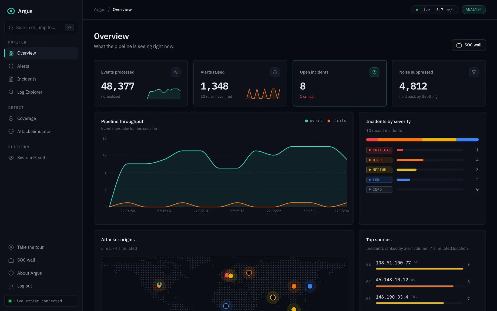
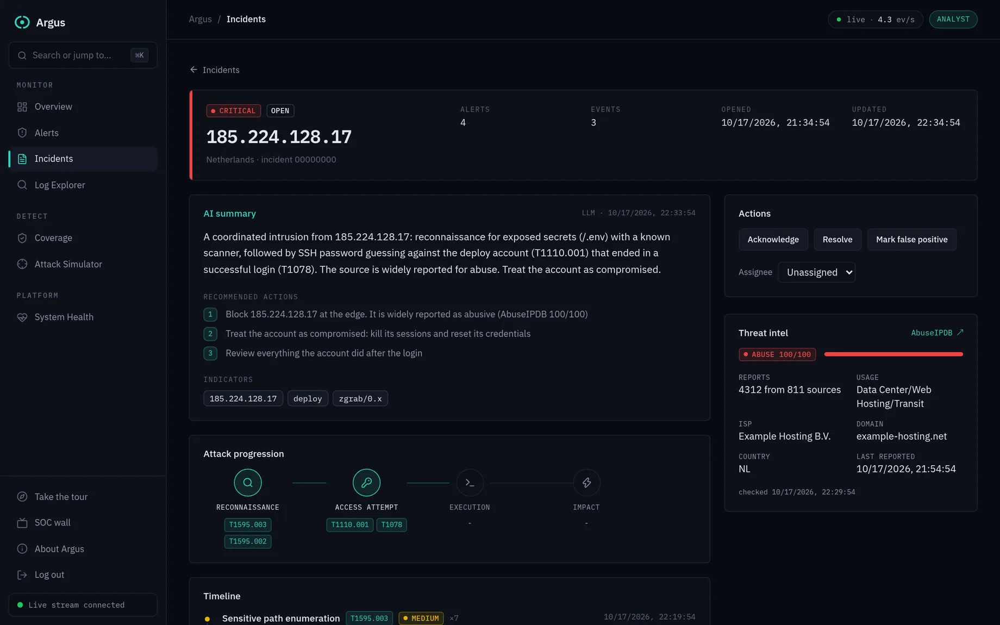
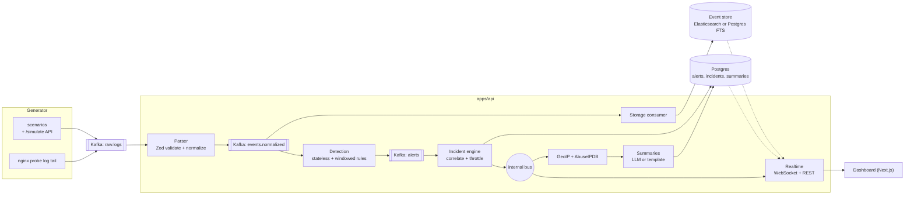

# Argus

Real-time security event analysis. Logs stream through Kafka, 12 detection rules mapped to MITRE
ATT&CK catch attacks as they happen, and every incident gets a short written summary of what
happened and what to do next.

**[Live demo](https://argus.buzz)** · [About](https://argus.buzz/about)



## What it does

- **Detects** brute force, password spraying, account takeover, SQL injection, XSS, command
  injection, path traversal, scanning, token abuse and rate abuse.
- **Correlates** alerts into one incident per source, and throttles repeats so a noisy scanner stays
  readable.
- **Explains** each incident with an LLM summary, or a deterministic template when no API key is
  set.
- **Enriches** public IPs with GeoIP and AbuseIPDB reputation.
- **Ingests real traffic.** Internet scanners probing the live server become real incidents next to
  the simulated ones.
- **Streams** everything to the console over WebSockets: live alerts, incident triage, log search,
  a per-event pipeline trace, ATT&CK coverage and an attack simulator.



## Architecture



Every event carries one id from the raw log to the incident, so the console can trace any event
through each stage. All message shapes live in one Zod contract package shared by every service.

## Detection coverage

12 rules, 11 techniques, 6 tactics. The mapping lives in
[`packages/contracts/src/rules.ts`](packages/contracts/src/rules.ts) and drives the console's
ATT&CK badges, the kill-chain view, the coverage page and the summaries.

| Rule | Detects | Severity | Technique | Tactic |
|---|---|---|---|---|
| `dir-enumeration` | Sensitive path enumeration | medium | [T1595.003](https://attack.mitre.org/techniques/T1595/003/) Wordlist Scanning | Reconnaissance |
| `scanner-user-agent` | Attack tool fingerprint | low | [T1595.002](https://attack.mitre.org/techniques/T1595/002/) Vulnerability Scanning | Reconnaissance |
| `traffic-anomaly` | Traffic anomaly | medium | [T1595](https://attack.mitre.org/techniques/T1595/) Active Scanning | Reconnaissance |
| `brute-force-ssh` | SSH brute force | high | [T1110.001](https://attack.mitre.org/techniques/T1110/001/) Password Guessing | Credential Access |
| `password-spraying` | Password spraying | high | [T1110.003](https://attack.mitre.org/techniques/T1110/003/) Password Spraying | Credential Access |
| `login-after-brute-force` | Login after brute force | critical | [T1078](https://attack.mitre.org/techniques/T1078/) Valid Accounts | Initial Access |
| `sqli-attempt` | SQL injection attempt | high | [T1190](https://attack.mitre.org/techniques/T1190/) Exploit Public-Facing Application | Initial Access |
| `path-traversal` | Path traversal attempt | high | [T1190](https://attack.mitre.org/techniques/T1190/) Exploit Public-Facing Application | Initial Access |
| `invalid-jwt` | Invalid token use | low | [T1550.001](https://attack.mitre.org/techniques/T1550/001/) Application Access Token | Defense Evasion |
| `xss-attempt` | Cross-site scripting attempt | medium | [T1059.007](https://attack.mitre.org/techniques/T1059/007/) JavaScript | Execution |
| `command-injection` | OS command injection attempt | high | [T1059.004](https://attack.mitre.org/techniques/T1059/004/) Unix Shell | Execution |
| `api-rate-abuse` | API rate abuse | medium | [T1499.003](https://attack.mitre.org/techniques/T1499/003/) Application Exhaustion Flood | Impact |

Each rule is unit tested, including benign look-alikes that must not fire. An end-to-end test runs
every simulator scenario through the real parser and engine to prove it trips its rule, and runs
benign background traffic to prove it trips nothing. Injection rules decode payloads repeatedly and
leniently, so double encoding or a malformed `%zz` escape doesn't slip a payload past them.

## Real attack traffic

nginx in front of the public API writes a second access log with **only requests for paths the API
doesn't serve** (`/.env`, `/wp-login.php`, `/cgi-bin/...`). Dashboard users never appear in it, but
scanners and exploit kits do. The generator tails that log into Kafka, following logrotate and
capping throughput per source, and from there it goes through the same rules as everything else.

Alerts are throttled to one per rule and source per minute, and the next alert reports how many it
stood in for. Public IPs are checked against AbuseIPDB, with lookups cached in Postgres for a day and
capped below the free tier's quota. Demo and internal IPs are never sent out.

## Deployment

The live instance runs on a small budget:

- **Dashboard** on Vercel.
- **Kafka, Redis, the API and the generator** on a 4 GB Azure VM shared with other services. Every
  container has a hard memory cap, and host nginx terminates TLS.
- **Postgres** on Azure Database for PostgreSQL. The VM uses the `lite` storage profile, which
  searches events with Postgres full-text search instead of running Elasticsearch.
- **Images** are built, scanned and pushed to GHCR by CI. The VM only pulls them. The API image
  ships the monthly DB-IP GeoIP database.

[`deploy/vm.sh`](deploy/vm.sh) handles the VM side: secret generation, preflight checks, the nginx
site, probe logging, deploys, backups, rollbacks and end-to-end verification.

## Security

- **Accounts and roles.** Admin, analyst and viewer, carried in a signed session and enforced on
  every request. Public deployments have no self sign-up; accounts are created from the CLI.
- **Rate limits** on every endpoint, with a tighter limiter on login. Behind a proxy, `TRUST_PROXY`
  keys them on the real client IP, so a forged `X-Forwarded-For` can't dodge them.
- **Transport.** TLS, HSTS and a strict CSP on the dashboard.
- **Supply chain.** CodeQL, gitleaks over the full history, and Trivy on dependencies and
  Dockerfiles, with a CycloneDX SBOM.
- **Runtime.** Scanned images, non-root containers.

## Running locally

Needs Node 24 (see `.nvmrc`), pnpm 10 (`corepack enable`) and Docker.

```bash
pnpm install
pnpm env:init                         # creates .env with a fresh AUTH_SECRET
pnpm infra:up                         # Kafka, Elasticsearch, Postgres, Redis
pnpm --filter @argus/api db:migrate
pnpm dev                              # generator, api and dashboard
```

Open http://localhost:3000. Background traffic starts right away. Fire a scenario from the Attack
Simulator page, or with `POST http://localhost:4200/simulate/:scenario`, and watch it become an
alert, an incident and a summary.

Locally, the first account registered at `/login` becomes admin. For a public instance, set
`ALLOW_REGISTRATION=false` and create accounts with:

```bash
pnpm --filter @argus/api user:create --email you@example.com --role admin
```

### Optional integrations

Everything runs with no API keys. Each of these adds one thing:

| Variable | Adds |
|---|---|
| `LLM_PROVIDER` + `GROQ_API_KEY` or `GEMINI_API_KEY` | LLM-written summaries instead of templates |
| `ABUSEIPDB_API_KEY` | IP reputation on incidents |
| `GEOIP_DB` | Map locations for real IPs (path to a DB-IP `.mmdb`) |
| `SLACK_WEBHOOK_URL` | Incident notifications |
| `GOOGLE_CLIENT_ID` + `NEXT_PUBLIC_GOOGLE_CLIENT_ID` | Sign in with Google |
| `NEXT_PUBLIC_DEMO_EMAIL` + `NEXT_PUBLIC_DEMO_PASSWORD` | A read-only demo button on the login page |
| `REDIS_URL` | Shared rule state and event bus across instances |
| `STORAGE_PROFILE=lite` | Postgres full-text search instead of Elasticsearch |
| `EVENT_RETENTION_DAYS` | How long raw events are kept |

### Commands

```bash
pnpm typecheck      # tsc across the workspace
pnpm lint           # eslint
pnpm test           # vitest
pnpm test:smoke     # Kafka to parser to store, against running infra
pnpm infra:down     # stop infra (infra:reset also wipes volumes)
```

## Repository layout

```
apps/
  generator/    scenario log emitter, probe log tail, /simulate API
  api/          parser, storage, detection, incidents, enrichment, summaries, realtime
  dashboard/    Next.js landing page and console
packages/
  contracts/    Zod schemas and the rule catalog shared by every service
  config/       env parsing, validated at boot
  logger/       pino structured logging
deploy/         VM script, nginx config
```

## Stack

TypeScript · Node 24 · Fastify · Kafka (KRaft) · PostgreSQL + Prisma · Elasticsearch · Redis ·
Next.js 16 · TanStack Query · Recharts · Framer Motion · Docker · GitHub Actions · pnpm + Turborepo

GeoIP data from [DB-IP](https://db-ip.com) IP to Country Lite (CC BY 4.0). Country centroids from
Google's DSPL dataset (BSD-3-Clause). Simulated attackers use IANA documentation ranges, which have
no real location, so their map pins are marked as simulated.

---

Built by [Aditya Kumar Jha](https://adiikj.dev).
