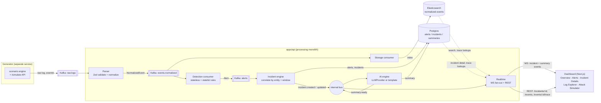

# Argus

> The hundred-eyed watchman — an AI-powered, event-driven security event analysis platform.

A scenario-driven log generator feeds **Kafka**. A processing monolith normalizes every event
against a shared **Zod** contract, runs a stateless + stateful **detection engine**, correlates
alerts into **incidents** (Postgres/Prisma), and asks an **LLM** for a plain-language incident
summary (with a deterministic template fallback — the whole stack runs with zero API keys). Every
alert, incident, and summary streams live over **WebSockets** to a real-time dark security-console
**dashboard** (Next.js), which also ships an interactive **Attack Simulator**, a **Log Explorer**,
and a **pipeline trace view** that follows one event from raw log to AI summary.


## Architecture



## Detection coverage

12 rules mapped to 11 MITRE ATT&CK techniques across 6 tactics. The mapping lives in one place,
`packages/contracts/src/rules.ts`, which drives the dashboard's ATT&CK badges, the kill-chain view,
the **Detection Coverage** page, and the AI summaries. Every rule has unit tests, including benign
look-alikes that must not fire. An end-to-end test runs every simulator scenario through the real
parser and engine to prove it trips its rule, and runs benign background traffic to prove it trips
nothing. Injection rules decode payloads repeatedly and leniently, so double encoding and a junk
`%zz` escape don't get a payload past them.

| Stage | Rule | Detects | Severity | MITRE ATT&CK technique | Tactic |
|---|---|---|---|---|---|
| Recon | `dir-enumeration` | Sensitive path enumeration | medium | [T1595.003](https://attack.mitre.org/techniques/T1595/003/) Active Scanning: Wordlist Scanning | Reconnaissance |
| Recon | `scanner-user-agent` | Attack tool fingerprint | low | [T1595.002](https://attack.mitre.org/techniques/T1595/002/) Active Scanning: Vulnerability Scanning | Reconnaissance |
| Recon | `traffic-anomaly` | Traffic anomaly | medium | [T1595](https://attack.mitre.org/techniques/T1595/) Active Scanning | Reconnaissance |
| Access | `brute-force-ssh` | SSH brute force | high | [T1110.001](https://attack.mitre.org/techniques/T1110/001/) Brute Force: Password Guessing | Credential Access |
| Access | `password-spraying` | Password spraying | high | [T1110.003](https://attack.mitre.org/techniques/T1110/003/) Brute Force: Password Spraying | Credential Access |
| Access | `login-after-brute-force` | Login after brute force | critical | [T1078](https://attack.mitre.org/techniques/T1078/) Valid Accounts | Initial Access |
| Access | `sqli-attempt` | SQL injection attempt | high | [T1190](https://attack.mitre.org/techniques/T1190/) Exploit Public-Facing Application | Initial Access |
| Access | `path-traversal` | Path traversal attempt | high | [T1190](https://attack.mitre.org/techniques/T1190/) Exploit Public-Facing Application | Initial Access |
| Access | `invalid-jwt` | Invalid token use | low | [T1550.001](https://attack.mitre.org/techniques/T1550/001/) Use Alternate Authentication Material: Application Access Token | Defense Evasion |
| Execution | `xss-attempt` | Cross-site scripting attempt | medium | [T1059.007](https://attack.mitre.org/techniques/T1059/007/) Command and Scripting Interpreter: JavaScript | Execution |
| Execution | `command-injection` | OS command injection attempt | high | [T1059.004](https://attack.mitre.org/techniques/T1059/004/) Command and Scripting Interpreter: Unix Shell | Execution |
| Impact | `api-rate-abuse` | API rate abuse | medium | [T1499.003](https://attack.mitre.org/techniques/T1499/003/) Endpoint Denial of Service: Application Exhaustion Flood | Impact |

## Stack

Node 24 · TypeScript (strict) · Fastify · Kafka (KRaft) · Elasticsearch · PostgreSQL (Prisma) ·
Next.js 16 · WebSockets · shadcn/ui · TanStack Query · Recharts · Framer Motion · Docker Compose ·
pnpm + Turborepo. Redis is optional (`REDIS_URL`) — backs the detection window store + internal bus
for multi-instance runs; unset, both stay in-process.

## Repository layout

```
apps/
  generator/    # scenario-driven log emitter -> Kafka, + the /simulate attack-trigger API
  api/          # processing monolith: streaming, parser, storage, detection, incident, ai, realtime
  dashboard/    # Next.js real-time dashboard (Overview, Alerts, Incident Details, Log Explorer, Attack Simulator)
packages/
  contracts/    # Zod schemas + inferred types — the single source of truth for every event
  config/       # env parsing + validation (fail-fast at boot)
  logger/       # pino structured logging + correlation-id helpers
```

## Prerequisites

- Node.js >= 20 (24 recommended — see `.nvmrc`)
- pnpm 10 (`corepack enable` picks up the pinned version)
- Docker + Docker Compose

## Getting started

```bash
# 1. Install dependencies
pnpm install

# 2. Configure environment (creates .env with a freshly generated AUTH_SECRET)
pnpm env:init
# On Windows/machines where 5432 or 4000 are already taken, see the comments in .env.example.

# 3. Boot infrastructure (Kafka, Elasticsearch, Postgres)
pnpm infra:up
pnpm infra:logs      # follow logs; wait for healthchecks to pass

# 4. Run the Postgres migration (alerts / incidents / summaries)
pnpm --filter @argus/api db:migrate

# 5. Run everything in dev mode (generator, api, dashboard)
pnpm dev
```

Then open the dashboard at **http://localhost:3000** — the landing page links straight into the live
console. The generator emits low-rate benign background traffic immediately, so the feed is never
empty; use the **Attack Simulator** page (or `POST http://localhost:4200/simulate/:scenario`) to fire
one of ten attack scenarios on demand and watch it become an alert, an incident, and an AI summary
in real time.


### Useful commands

```bash
pnpm typecheck           # tsc across the workspace
pnpm lint                # eslint
pnpm format              # prettier --write
pnpm test                # vitest — parsers, detection rules, window store, scenarios, ai queue
pnpm test:smoke          # real Kafka -> parse -> store integration check (needs infra + api running)
pnpm infra:down          # stop infra   |   pnpm infra:reset wipes volumes
```

### Running with a real LLM

The AI layer runs with **zero API keys** by default (deterministic template summaries). To get real
LLM-generated summaries, set in `.env`:

```bash
LLM_PROVIDER=groq            # or "gemini"
GROQ_API_KEY=...             # or GEMINI_API_KEY
```

### Auth + rate limiting

Real per-user accounts (email + password, plus optional "Sign in with Google") gate the console —
`AUTH_SECRET` in `.env` signs sessions and is required. Every account has a role — **admin**,
**analyst** (triages incidents), or **viewer** (read-only; the api 403s every write) — carried in the
signed session token and enforced server-side on every request.

- **Local dev** (`ALLOW_REGISTRATION=true`): a fresh install runs fully open until the first account
  registers at `/login` (it becomes admin), then every route requires a valid session — the same
  bootstrap pattern self-hosted tools like Grafana/Gitea use.
- **Public deployments** (`ALLOW_REGISTRATION=false`): no self sign-up, and the gate is on from boot
  even with zero accounts, so nobody can claim a fresh instance by registering first. Accounts come
  from the CLI (password via hidden prompt, never argv):
  `pnpm --filter @argus/api user:create --email you@example.com --role admin`. Set
  `NEXT_PUBLIC_DEMO_EMAIL`/`NEXT_PUBLIC_DEMO_PASSWORD` to a `viewer` account to put an
  "Explore the live demo" button on the login page. Set
`GOOGLE_CLIENT_ID` (api) and `NEXT_PUBLIC_GOOGLE_CLIENT_ID` (dashboard, same value) to enable Google
sign-in alongside email+password; leave both blank to run email+password only. The generator's
`/simulate/:scenario` and every api REST endpoint are token-bucket rate limited regardless (login/
register/Google endpoints get a tighter limiter against brute-forcing; `TRUST_PROXY` — the proxy's
addresses, e.g. `loopback,uniquelocal` — makes the limiter key on the real client IP behind a
reverse proxy), so a public demo URL can't be
scripted into hammering the LLM's free-tier quota or guessing passwords.
